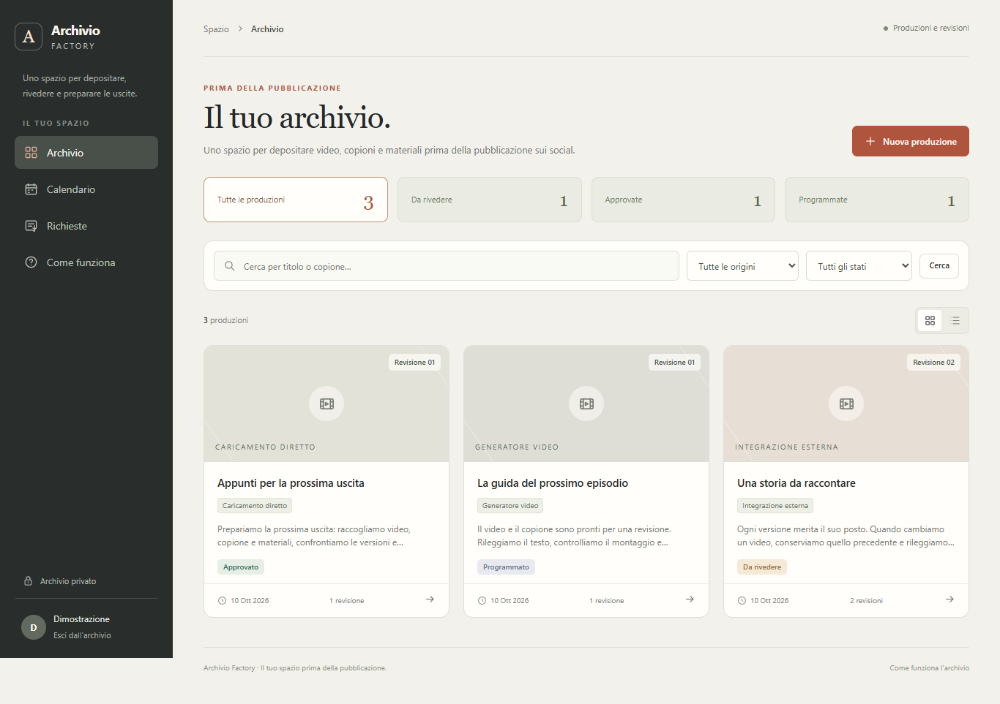

# Archivio Factory

Uno spazio privato dove depositare i propri video, copioni e materiali prima della pubblicazione sui social. Permette di rivederli, conservare le versioni, raccogliere note e scegliere quando far uscire la versione approvata.

Ogni persona o gruppo può installarlo per gestire il proprio archivio. Il repository GitHub ospita il codice open source; i video, i copioni e i dati dell'installazione restano nello spazio privato scelto da chi lo utilizza.

Il codice di questo progetto è originale e distribuito con [licenza MIT](LICENSE): è gratuito da usare, modificare e distribuire, anche commercialmente, conservando l'avviso di licenza. Server, spazio disco e servizi esterni eventualmente collegati hanno i propri costi. Le dipendenze conservano le rispettive licenze. Il progetto non incorpora codice di MediaCMS o Reloops.



Anteprima con soli dati sintetici. [Rapporto di collaudo](docs/COLLAUDO.md) · [Licenze delle dipendenze](docs/DIPENDENZE.md) · [Sicurezza](SECURITY.md).

## Cosa funziona

- Spazi privati con accessi da lettore e revisore.
- Produzioni organizzate per origine e riferimento esterno; revisioni numerate con video, copione, nota e allegati.
- Video e allegati immutabili nell'applicazione, con SHA-256 e controllo di integrità prima dello scaricamento.
- Approvazione legata alla revisione esatta: una nuova versione richiede una nuova approvazione.
- Note anche con indicazione del secondo del video; richieste su copione, montaggio, voce e sottotitoli.
- Calendario editoriale delle revisioni approvate e registrazione manuale dell'avvenuta pubblicazione.
- API private, ponte Python, pacchetti di revisione e backup SQLite con ripristino verificato in una cartella nuova.

Si può usare direttamente dal browser per caricare video e copioni, rivedere il lavoro e preparare le uscite. Non richiede uno specifico generatore video. Se si collega un processo esterno, il ponte può esportare le richieste di modifica insieme ai materiali della versione scelta: quel processo deve poi eseguirle. Il calendario registra le uscite previste; la pubblicazione sui social va effettuata sul relativo servizio. [Integrazione facoltativa con la Factory](docs/FACTORY.md).

## Avvio locale su Windows

Requisito: Python 3.12 o successivo. Aprire PowerShell nella cartella di questo repository.

```powershell
py -3.12 -m venv .venv
.\.venv\Scripts\python.exe -m pip install --require-hashes --only-binary=:all: -r requirements-lock.txt
.\.venv\Scripts\python.exe manage.py migrate
.\.venv\Scripts\python.exe manage.py createsuperuser --username dennis
.\.venv\Scripts\python.exe manage.py crea_spazio "Archivio personale" dennis
.\.venv\Scripts\python.exe avvia_locale.py
```

La password viene richiesta dal comando Django. Aprire **http://127.0.0.1:58540/** e accedere con l'utente creato. Il comando `crea_spazio` assegna a quell'utente il ruolo di revisore nello spazio; essere un superutente non sostituisce l'appartenenza allo spazio. L'avvio resta sul computer locale. Chiudere con Ctrl+C.

## Avvio locale su Linux

```bash
python3 -m venv .venv
.venv/bin/python -m pip install --require-hashes --only-binary=:all: -r requirements-lock.txt
.venv/bin/python manage.py migrate
.venv/bin/python manage.py createsuperuser --username dennis
.venv/bin/python manage.py crea_spazio "Archivio personale" dennis
.venv/bin/python avvia_locale.py
```

Per una prova con materiale sintetico, usare `manage.py inizializza_demo [--username demo]` sul database locale SQLite: crea tre produzioni e quattro revisioni, e salva una password casuale soltanto nel file privato `runtime/accesso-demo.json`. Il comando indica il percorso e rifiuta un utente o un file demo già esistenti. Non condividere quel file e non usare l'utente demo per un'installazione pubblica.

## Primo utilizzo

1. Creare una produzione, scegliere l'origine e depositare il video insieme al copione e agli eventuali allegati.
2. Aprire la revisione e guardare il video. Aggiungere note o una richiesta di modifica indicando cosa cambiare.
3. Quando un nuovo video è pronto, depositarlo nella stessa produzione: la versione precedente resta disponibile.
4. Approvare la versione scelta, poi registrare piattaforma e data futura di uscita. La programmazione resta legata a quella versione.
5. Dopo la pubblicazione effettiva, registrarla nell'archivio.

Per poter rifare un montaggio, depositare anche il materiale necessario: progetto o timeline, immagini, audio, sottotitoli e metadati. Il solo MP4 finale non ricostruisce un progetto di montaggio o le impostazioni del generatore. I file ricevuti vengono conservati come dati e non eseguiti.

## Integrazione facoltativa con la Factory

Creare una chiave limitata allo spazio:

```powershell
.\.venv\Scripts\python.exe manage.py genera_chiave UUID_DELLO_SPAZIO "Deposito Factory"
```

Il token viene mostrato una sola volta: conservarlo in un gestore di segreti. Caricarlo nell'ambiente del processo che usa il ponte, sotto `ARCHIVIO_FACTORY_API_KEY`; non inserirlo in comandi salvati, JSON di workflow o Git. Un esempio senza credenziali:

```powershell
.\.venv\Scripts\python.exe client_factory.py deposita --titolo "Video di prova" --origine altro --riferimento-factory "episodio-001" --video "C:\Video\video.mp4" --copione "C:\Video\copione.txt" --allegato "C:\Video\sottotitoli.srt"
```

Lo stesso riferimento identifica la stessa produzione; ripetere un deposito identico restituisce la stessa revisione. Cambiare video, copione, nota o allegati crea una nuova versione. Gli esempi completi e l'API sono in [docs/FACTORY.md](docs/FACTORY.md) e [examples](examples/README.md).

## Dati e backup

Il codice resta nel repository; i dati locali sono in `runtime/db.sqlite3` e `runtime/media/`, esclusi da Git. La chiave Django locale viene generata in `runtime/secret.key`, anch'essa esclusa. È possibile spostare i dati con `ARCHIVIO_RUNTIME_ROOT` e `ARCHIVIO_MEDIA_ROOT`.

Creare prima una cartella di backup **fuori da questo repository**, quindi esportare un nome nuovo:

```powershell
.\.venv\Scripts\python.exe scripts/backup.py --runtime "C:\Archivio\runtime" --output "D:\BackupArchivio\archivio-2026-10-10.zip"
.\.venv\Scripts\python.exe scripts/ripristina.py --backup "D:\BackupArchivio\archivio-2026-10-10.zip" --destinazione "C:\Archivio\runtime-ripristinato"
```

Su Linux gli stessi comandi accettano percorsi come `/srv/archivio/runtime` e `/mnt/backup/archivio.zip`. Se si usa la cartella predefinita, `--runtime` può essere omesso. Se `ARCHIVIO_MEDIA_ROOT` è diverso, passare anche `--media-root` al backup.

Il backup usa la API online di SQLite, conserva la snapshot del database e tutti i blob da essa referenziati, e verifica i byte copiati. Non include upload incompleti o file orfani, codice, `.env`, chiave Django o token Factory in chiaro. Il ripristino rifiuta una destinazione esistente, percorsi pericolosi, file manomessi e riferimenti mancanti; non modifica l'originale. I backup contengono video privati, copioni, utenti e hash delle password e delle chiavi Factory: conservarli con accessi limitati e, dove necessario, su supporto cifrato.

Prima di usare la copia ripristinata, fermare l'applicazione, configurare `ARCHIVIO_RUNTIME_ROOT` verso la nuova cartella e controllare che `ARCHIVIO_MEDIA_ROOT` non punti ancora all'originale. Per SQLite, rimuovere `DATABASE_URL` dall'ambiente e da `.env`. La chiave Django va recuperata da una custodia separata, oppure generata di nuovo in sviluppo: una chiave nuova invalida le vecchie sessioni e le firme dei pacchetti precedentemente esportati. Le password e gli hash delle chiavi Factory sono nel database; i token Factory in chiaro devono restare nel proprio gestore di segreti.

Una copia sullo stesso disco non protegge dalla perdita del disco. Conservare almeno una copia separata e provare periodicamente il ripristino. Vedere [aggiornamenti e recupero](docs/AGGIORNAMENTI.md).

## Configurazione e verifiche

Il file [.env.example](.env.example) elenca i parametri: copiarlo in `.env` senza aggiungerlo a Git. Per PostgreSQL/Supabase usare [la guida dedicata](docs/SUPABASE.md); per controlli, limiti e produzione vedere [SICUREZZA.md](docs/SICUREZZA.md). L'avvio Django locale non è il server da esporre su Internet.

```powershell
.\.venv\Scripts\python.exe manage.py check
.\.venv\Scripts\python.exe manage.py test
```

I test del ponte usano un server HTTP sintetico su loopback; i test di backup usano SQLite e file temporanei reali. Non chiamano la Factory reale o servizi cloud. Per ambienti di test che limitano la cartella temporanea, `ARCHIVIO_TEST_TMP` può indicare una cartella esistente fuori dal repository. La compatibilità con un progetto Supabase reale e con il dispatcher della propria Factory va verificata nella rispettiva installazione.
